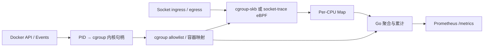

# luna-ebpf

[](https://github.com/AllenxuX/luna-ebpf/actions/workflows/test.yaml)
[](LICENSE)

**基于 eBPF 的 Docker 容器网络流量 Prometheus Exporter，支持 Host Network。**

中文 | [English](README.en.md)

共享网络命名空间，也能按容器分别统计 RX/TX。luna-ebpf 使用 Go、[cilium/ebpf](https://github.com/cilium/ebpf) 和 bpf2go，通过 Socket 所属 cgroup 关联 Docker 容器，不使用共享网卡总量分摊流量。

## 功能

- 自动发现所有运行中的 Docker 容器，不按网络模式过滤。
- 导出每个容器 RX/TX Bytes、Packets 累计计数器，附带完整容器 ID 和名称。
- 支持启动、更名、重启、退出自动更新与 Map 清理。
- 提供 Prometheus 配置、Grafana Dashboard、n9e 告警示例。
- 支持 Docker Compose 和 systemd 部署；无需 Cilium 集群或 Kubernetes。

## 快速开始

需要 Linux、Docker Engine、Docker Compose v2 和 **cgroup v1 或 v2**。v1 使用 socket-trace MVP，要求可读的内核 BTF 和所需 kprobe；缺少 BTF 的旧内核不支持该后端。运行时需要访问宿主机 PID/cgroup 与 Docker Socket，并具备加载和附加 BPF 的权限。

```bash
git clone https://github.com/AllenxuX/luna-ebpf.git
cd luna-ebpf
docker compose up -d --build
curl -fsS http://127.0.0.1:9808/readyz
curl -fsS http://127.0.0.1:9808/metrics
```

Compose 从源码构建本地 `luna-ebpf:0.1.3` 镜像，不依赖私有镜像仓库。首次构建需要下载基础镜像、Go 依赖和编译工具。Exporter 自身也会作为容器被发现。

```bash
docker compose logs -f
docker compose down
```

默认仅监听 `127.0.0.1:9808`。远程 Prometheus 抓取时可修改 Compose 的监听参数；HTTP 未提供认证/TLS，请通过防火墙或反向代理控制访问。Compose 使用 `privileged: true`；Docker Socket 即使挂载为 `:ro`，仍具有 Docker API 权限。

## 指标

| 指标 | 含义 |
|---|---|
| `luna_container_rx_bytes_total` | 容器累计接收字节 |
| `luna_container_tx_bytes_total` | 容器累计发送字节 |
| `luna_container_rx_packets_total` | 容器累计接收 skb 次数 |
| `luna_container_tx_packets_total` | 容器累计发送 skb 次数 |
| `luna_exporter_up` | Exporter 附加与采样健康状态 |
| `luna_exporter_docker_connected` | Docker 发现连接状态 |
| `luna_exporter_containers` | 已成功映射的运行中容器数 |

容器指标标签：`container_id`、`container_name`。无 IP 流量的容器导出零值。

```promql
# 每个容器的发送速率，Mbps
sum by (instance, container_id, container_name) (
  rate(luna_container_tx_bytes_total[5m])
) * 8 / 1000000
```

导入 [Grafana Dashboard](deploy/grafana/luna-ebpf-dashboard.json)，选择 Prometheus 数据源即可使用。更多指标与告警见 [监控配置](docs/monitoring.md)。

## 工作原理



默认 `--collector-backend auto`：v2 使用原有 cgroup-skb，v1 使用 socket-trace 并选择控制器层级（优先 memory）。可指定 `cgroup-skb` 或 `socket-trace`；v2 也可强制使用后者。socket-trace 从内核 BTF 读取结构布局，不猜测偏移。

内核程序始终保留报文 verdict。RX/TX 分别归属接收/发送 Socket 的 cgroup；共享 netns 不意味着共享计数。

## 范围与限制

| 场景 | 当前状态 |
|---|---|
| host、默认/自定义 bridge、共享 netns | cgroup v2 / cgroup-skb 已验证 TCP/UDP 独立归属 |
| none | 纳入发现，无 IP 流量时为零 |
| macvlan、ipvlan | 已验证同机通信；未验证外部物理网络、ipvlan L3 |
| Swarm overlay、其他插件 | 不限制发现，具体路径尚未验证 |

v1 socket-trace 当前是 IPv4/IPv6 TCP/UDP MVP，已在真实 v1/v2 Linux 环境验证，不保证 RAW/ICMP 覆盖。TX 在 `ip_output` / `ip6_output`、RX 在 TCP/UDP 接收探针观察 skb；与 v2 的观察点不同，不能要求两种后端计数逐包一致。

Bytes 是 Hook 处 `skb->len`，Packets 是 Hook 调用次数，**不是网卡物理包数或应用 payload**。不采集 Unix Socket；纯转发、全部 RAW Socket、隧道及 Socket 传递场景不保证完整覆盖。发现前的流量不能追回；Agent 重启会重置计数。

已在 Rocky Linux 9.7、内核 5.14、Docker 29.5.2、cgroup v2 上验证。内核版本本身不能保证兼容；其他环境请先执行 `--check` 并验证真实流量。见 [验证范围](docs/validation.md)。

## 开发与文档

```bash
make generate             # 需要 Go、Clang BPF target、LLVM
make build
make test race lint
sudo ./bin/luna-ebpf --check
```

生成的 BPF ELF/Go 绑定已随源码提供；普通 Go 构建无需 Clang。Go 最低版本 1.25.6，运行目标 Linux amd64/arm64；arm64 目前只验证构建。

| 文档 | 内容 |
|---|---|
| [部署与配置](docs/deployment.md) | Compose、systemd、配置参数 |
| [架构](docs/architecture.md) | 内核计数、身份映射、生命周期 |
| [指标语义](docs/metric-semantics.md) | 计量口径、重置、发现窗口 |
| [监控配置](docs/monitoring.md) | Prometheus、Grafana、n9e |
| [开发与贡献](CONTRIBUTING.md) | 构建、测试、PR |
| [运维](docs/operations.md) | 权限、内核、故障排查 |

## License

项目代码采用 [Apache-2.0](LICENSE)。随附的 libbpf 头文件保留原有许可证和版权声明，见 [第三方声明](THIRD_PARTY_NOTICES.md)。
