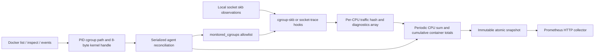

# Architecture

Backend selection is `--collector-backend auto|cgroup-skb|socket-trace`. Auto
retains cgroup-skb on v2 and selects socket-trace on v1; socket-trace can also
be forced on v2. Cgroup-skb requires v2. Both retain the explicit cgroup
allowlist, socket-based identity and existing metric names/labels.

The cgroup-skb backend in `internal/bpf/traffic.bpf.c` has one ingress and one egress program. Each gets
socket identity with `bpf_skb_cgroup_id`, checks the allowlist, adds `skb->len`
and one invocation to a per-CPU value, and always returns 1. First insertion
uses NOEXIST then re-lookup, including concurrent EEXIST. Zero IDs and map
failures go to a fixed-size per-CPU diagnostic array. The 16-byte key contains
ID, direction (RX=0/TX=1), and a zero reserved field. The 16-byte value contains
bytes and packets; all fields are native-endian. Only little-endian amd64 and
arm64 are supported in this MVP. Generated ELF and Go bindings are included.

The cgroup-skb loader adjusts both hash capacities before loading, populates
the allowlist before attaching, and uses cilium `link.AttachCgroup`. The library
uses a cgroup BPF link where available, or its non-destructive multi-attach
fallback; exclusive existing attachments produce an error. A failed second
attach closes the first link. Closing affects only these owned links; nothing
is pinned. Verifier errors are wrapped with helper/permission/conflict advice.

The socket-trace MVP requires readable kernel BTF and the required kprobes.
It derives structure layouts from BTF rather than guessed offsets. Socket
creation and clone observations associate sockets with the selected cgroup
hierarchy; discovery seeds existing sockets by scanning `cgroup.procs` and
`/proc/PID/fd`. Owner maps are bounded to `min(8 * trafficEntries, 1048576)`.
These FD scans increase discovery work. TX counts skb observations at
`ip_output` / `ip6_output`; RX uses TCP/UDP receive probes. The MVP
covers IPv4/IPv6 TCP/UDP, without guaranteed RAW/ICMP coverage. Probe programs
observe traffic without changing packet verdicts. These observation points
differ from cgroup-skb, so counters need not match packet for packet.

`internal/cgroup` reads the actual host PID cgroup file twice, validates the
unified hierarchy or selected v1 controller and confines the path under its root,
then gets each directory ID from `unix.NameToHandleAt`. V1 selects a full-root
mounted controller hierarchy, preferring memory, then pids/cpuset/cpu and other
available controllers. It checks the matching cgroup filesystem and eight-byte handles, never
uses inode numbers for identity, rejects shared root cgroups, and bounds each
subtree scan to 1024 directories by default. An over-limit or incomplete scan
is rejected rather than exposing a guessed partial attribution. Discovery retains
the last verified mapping for a confirmed-running container on a temporary
scan failure, retries it, and never assigns an unverified new cgroup ID. Subdirectories
are rescanned with full Docker reconciliation (30 seconds by default).

`internal/docker` uses the fixed Moby client module, API negotiation, running
container list and inspect, all network modes for running containers, full container IDs,
actual PID paths and creation/start timestamps. A second inspect verifies that
the running state, PID and start time did not change during the cgroup scan,
rejecting the common exit/PID-reuse attribution race. Missing PID/path/permissions
are counted and logged. Transport/daemon errors invalidate the whole inventory
request. The agent preserves its last successful view in that case. Docker
events trigger full reconciliation; reconnect uses a cancellable 1–30 second
exponential backoff. Every reconnect and the periodic timer force reconciliation.

`internal/agent/engine.go` is a single-goroutine state machine. Overlapping
subtrees resolve to the nearest actual Docker container ancestor; unrelated ID
collisions are rejected. New allowlist entries all succeed before new metadata
is published. Exited containers are first frozen in the HTTP snapshot, then
their allowlist and both direction keys are removed. Failed cleanup is retried,
and IDs cannot be reassigned before cleanup succeeds. Polling also deletes late
orphan keys left by in-flight hooks. Container metrics remain frozen for the
grace interval (60 seconds), then disappear; kernel maps are cleaned immediately.

Raw CPU totals are converted to cumulative per-container totals by deltas.
Those totals survive replacement/removal of child cgroups and a container
restart with the same Docker ID while its state is retained. Cgroup IDs alone
are never exported as Prometheus labels. A newly created Docker container has
a different full ID and starts a new counter series.

`internal/collector` rejects partial map polls and sums all possible CPUs.
`internal/metrics` implements stable Describe and dynamic constant Counter
metrics with exactly two container labels. HTTP handlers only read the last
immutable atomic snapshot, with no Docker calls or kernel traversals on scrape.
An unsuccessful poll keeps the last totals, sets up=0 and increments errors.

Startup validates host proc/cgroup namespace and root mount, Docker info,
inventory, actual BPF load, allowlist, required backend links and initial sample before
serving HTTP. `--check` executes that same path then closes links/objects.
SIGINT/SIGTERM cancels events/timers, shuts down HTTP, closes links/maps and
the Docker client. Windows builds contain an explicit runtime rejection and
support portable unit tests only.
